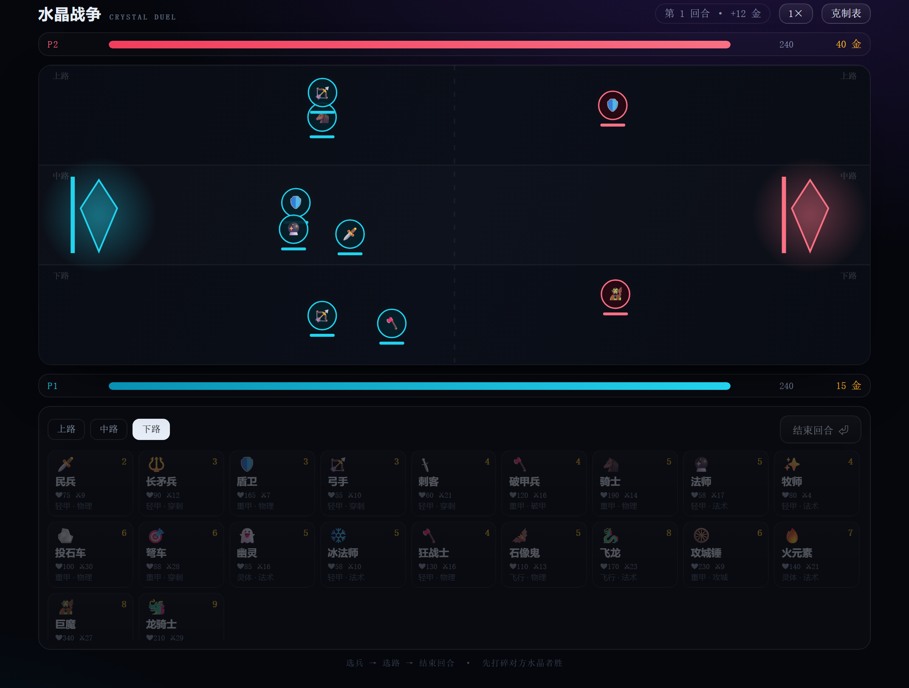

# 水晶战争 · CRYSTAL DUEL

### ▶ [**点这里直接开打** → chao-wen-s.github.io/crystal-duel](https://chao-wen-s.github.io/crystal-duel/)

20 种兵种、三条路、两座水晶。**双人同屏对战**，一人一回合买兵布阵，然后看它们自己打。



## 一句话玩法

每回合双方拿到**数额不同的金币**（12 → 10 → 15 → 9 → 17…），花光它，选兵、选路、点「结束回合」。兵会自己向前推进，同一条路上的敌人相遇就开打，打到对面水晶就拆家。

**先打碎对方水晶的人赢；第 15 回合结算时若双方水晶仍在，则水晶生命较低者失败，相同则平局。**

## 怎么玩

1. 开局选「双人同屏」或「人机对战」；人机模式支持简单、普通、困难三档。
2. 点卡片买兵（扣金币），兵会先「排队」在你的半场，按 `上路 / 中路 / 下路` 决定投放路线。
3. 点「结束回合 ⏎」。双人模式下会遮屏提醒换人；购买期双方都看不到对方待部署兵种与路线，战斗期才完全公开。
4. 战斗自动进行，右上角 `1×` 可切 2× / 4× 加速。
5. 回合结算后进入下一回合，金币重新发放（每回合数额都不同）；每方每回合最多部署 12 个单位。

## 20 兵种与克制

四个护甲类型：**轻甲 / 重甲 / 灵体 / 飞行**；五种攻击类型：**物理 / 穿刺 / 破甲 / 法术 / 攻城**。

| 攻击 \ 护甲 | 轻甲 | 重甲 | 灵体 | 飞行 |
|---|---|---|---|---|
| 物理 | 1.00 | 0.55 | 0.45 | 1.00 |
| 穿刺 | 1.20 | 0.80 | 0.60 | **1.60** |
| 破甲 | 0.90 | **1.80** | 0.70 | 0.90 |
| 法术 | 1.00 | 1.15 | **1.60** | 1.00 |
| 攻城 | 0.50 | 0.50 | 0.50 | 0.00 |

所以：**重甲怕破甲兵，飞行怕穿刺，灵体只怕法术，攻城锤只拆家**。看到对面一堆盾卫，就该买破甲兵；看到飞龙，就该上弩车。

兵种覆盖：民兵、长矛兵、盾卫、弓手、刺客、破甲兵、骑士、法师、牧师、投石车、弩车、幽灵、冰法师、狂战士、石像鬼、飞龙、攻城锤、火元素、巨魔、龙骑士。

特殊效果：法师/投石车/飞龙/火元素**溅射**，牧师**治疗光环**，冰法师**减速**，狂战士**残血增伤**，巨魔**回血**，攻城锤**对水晶 ×2.2**。

## 设计笔记

- **三路是各自的独立战场**：不同路的兵不会互相阻挡，所以「把兵全堆一路」能直接绕开对面的防守——这是一种赌博，也是这游戏最核心的心理战。
- **水晶会反击**：靠得太近的敌人会被点名射击，所以拆家不是免费的。
- **金币每回合不一样**：收入表是固定的 `12, 10, 15, 9, 17, 12, 20...`，双方同额。穷回合攒钱、富回合爆兵，是这个游戏的经济层。
- **先手与信息**：双人模式下玩家 1 先买，但购买期双方队列完全隔离，玩家 2 不能看到玩家 1 买了什么或放在哪一路；战斗期信息公开。先手胜率通过数据监控，目标为 50% ± 5%。

## 本地运行

单文件、零依赖、零网络请求：

```bash
# 直接双击 index.html，或者
python -m http.server 8000
```

## 自动化测试

启动静态服务器后打开：

```text
http://localhost:8000/tests/v2-browser-tests.html
```

测试覆盖调试接口隔离、初始状态、购买撤销、12 单位上限、三档 AI、双人交接、克制矩阵、倍速确定性、双水晶平局、第 15 回合终局、重开清理、可访问性和 24 单位压力模拟。

## 技术

原生 JS + Canvas，单文件。战斗使用固定 1/60s 步长、帧间余量累积与可复现随机种子，1× / 2× / 4× 只改变推进速度；音效是 WebAudio 现场合成。

## V2.0 实现状态

- 双水晶同帧归零判平局，第 15 回合强制终局。
- 每方每回合最多 12 个单位；支持撤销最近一次购买。
- 购买期信息隔离，战斗期完全公开。
- 三档 AI：简单、普通、困难。
- 固定步长与种子随机数，倍速结果可复现。
- 重开完整重置冷却、AI 记忆、随机种子与模拟余量。
- 键盘操作、焦点管理、ARIA 状态摘要、移动端触控尺寸与低动态适配。
- 生产默认不暴露调试写接口；使用 `?debug=1` 打开调试面板。

## 文档

代码评审报告、V2.0 PRD、软件测试报告、公众号文章与小红书素材都在 [`docs/`](docs/README.md)。

---

<sub>给喜欢算的人：赢的关键不是买贵的，是买对的。</sub>
